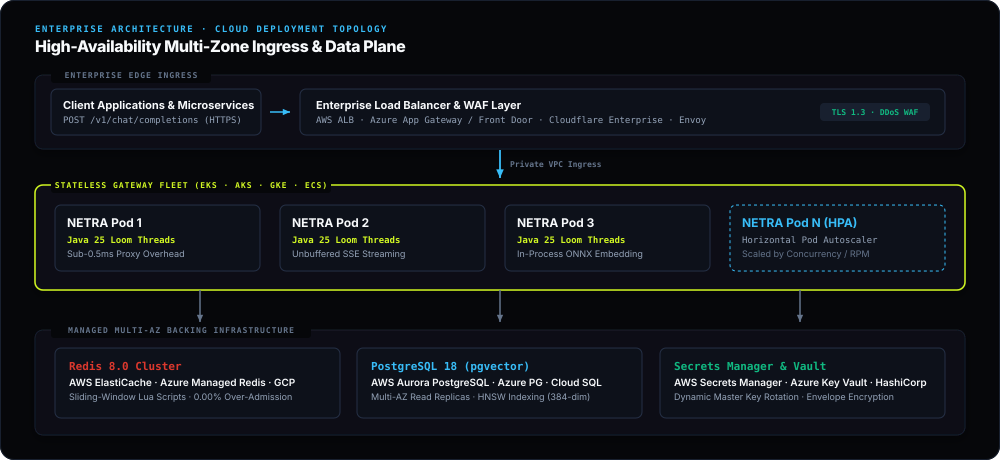

# Self-Hosting & Deployment Guide

NETRA is designed for versatile self-hosting across local container environments, developer platform-as-a-service (PaaS) clouds, and zero-cost cloud VPS virtual machines.

---

## 1. Deployment Topology Matrix

| Platform | Configuration Source | Ingress Port | Components Deployed | Target Use Case |
|---|---|---|---|---|
| **Local Docker Compose** | `docker-compose.yml` | `8080` (API), `3000` (UI) | Gateway, PostgreSQL 18 (pgvector), Redis 8.0, Mocks, Ops Console | Local development & testing |
| **Railway** | `deploy/paas/railway.toml` | Auto-assigned HTTPS | Gateway + Managed PostgreSQL + Redis | 1-Click developer PaaS |
| **Render** | `deploy/paas/render.yaml` | Auto-assigned HTTPS | Web Service + PostgreSQL + Redis | Blueprint Infrastructure-as-Code |
| **Fly.io** | `deploy/paas/fly.toml` | Edge Anycast IPv4/IPv6 | Edge microVM with auto-scaling | Low-latency edge inference |
| **Vercel** | `deploy/paas/vercel.json` | Global Edge CDN | React 19 Ops Console + API reverse proxy rewrites | Serverless frontend hosting |
| **Production Cloud VM & VPS** | `deploy/cloud-vps/setup-vps.sh` | `8080`, `3000` | Full containerized stack via Docker Compose | Production VPS & cloud VM |

---

## 2. Tier 1: Local Docker Compose (Developer Mode)

The multi-container stack includes the core Java 25 gateway, PostgreSQL 18 with `pgvector`, Redis 8.0 Alpine, mock providers (`alpha` on 9001, `beta` on 9002), and the React 19 / Vite 6 Ops Console.

### 2.1 Starting the Stack
```bash
git clone https://github.com/shashankch/netra-llmgateway.git
cd netra-llmgateway

# Production stack (gateway, postgres, redis, console)
docker compose up -d --build

# Or with offline mock provider containers (dev profile)
docker compose --profile dev up -d --build
# or using the developer Makefile:
make dev
```

### 2.2 Exposed Services & Health Endpoints

-  **Operations Console UI:** `http://localhost:3000`
-  **Core Gateway Data Plane:** `http://localhost:8080/v1/chat/completions`
-  **Actuator Health & Metrics:** `http://localhost:8080/actuator/health`
-  **PostgreSQL 18 (pgvector):** `localhost:5432` (`user: netra`, `password: netra`, `db: netra`)
-  **Redis 8.0:** `localhost:6379`
-  **Mock Provider Alpha (dev profile):** `http://localhost:9001`
-  **Mock Provider Beta (dev profile):** `http://localhost:9002`

!!! tip "Docker Compose Profiles: Clean Production vs. Development"
    Mock upstream containers (`mock-alpha`, `mock-beta`) and the local Ops Console container (`console`) are isolated under profiles (`["dev", "test"]` and `["local", "console"]`). Standard `docker compose up -d` boots strictly core backend data plane infrastructure (`gateway`, `postgres`, `redis`), eliminating unnecessary memory overhead in production environments where the UI is deployed externally or hosted via CDN.

!!! tip "Port Allocation & Local vLLM Drills"
    The documentation preview server (`make docs-serve`) binds to port 8000 by default. If testing with an in-VPC vLLM instance locally on port 8000, specify an alternate port (`uv run --with zensical zensical serve --dev-addr 127.0.0.1:8008`) or route to `VLLM_BASE_URL=http://localhost:8001/v1`.

### 2.3 Operations Console UI Deployment & Serving

The React 19 Ops Console (`console/`) can be served via Docker Compose, standalone Node/Vite, or static edge hosting:

#### Option A: Docker Compose (Default Nginx Container)
Packaged with a multi-stage Dockerfile and optimized `nginx:alpine` runtime on port 3000:
```bash
docker compose up -d console
```

#### Option B: Standalone Node.js & Vite
```bash
# Development with hot-reload (port 3000)
make console-dev        # or: cd console && npm install && npm run dev

# Production build & preview server
make console-build
make console-serve      # or: cd console && npm run preview
```

#### Option C: Edge Hosting (Vercel / Cloudflare Pages)
Deploy directly from `console/` using the provided blueprint (`deploy/paas/vercel.json`):
```bash
cd console && vercel --prod
```

### 2.4 Essential Environment Variables

#### Backend Gateway (`.env`)
| Variable | Default / Example | Purpose |
|---|---|---|
| `SPRING_PROFILES_ACTIVE` | `dev` (or `prod`) | Profile selector: `dev` for local mock providers, `prod` for live upstream providers |
| `OPENROUTER_API_KEY` | `sk-or-v1-...` | API key for upstream model aggregator routing (OpenRouter / compatible endpoints) |
| `OPENAI_API_KEY` | `sk-proj-...` | *(Optional)* Direct OpenAI API key if bypassing aggregator |
| `VLLM_BASE_URL` | `http://localhost:8000/v1` | *(Optional)* In-VPC private endpoint (vLLM / Ollama) |
| `NETRA_ADMIN_TOKEN` | `netra-admin-demo` | Bearer token for `/admin/*` control plane and analytics endpoints |
| `NETRA_UI_PASSWORD` | `netra@admin` | Operator lock-screen password for Ops Console sessions (24h HTTP-only cookie) |
| `SPRING_DATASOURCE_URL` | `jdbc:postgresql://localhost:5432/netra` | PostgreSQL JDBC connection string (auto-resolved in Docker) |
| `SPRING_DATA_REDIS_HOST` | `localhost` | Redis host for atomic rate limiting and sliding-window quotas |
| `CLOUDFLARE_TUNNEL_TOKEN` | `eyJhIjoi...` | *(Optional)* Cloudflare Tunnel token for zero-open-port ingress |

#### Frontend Operations Console (`console/.env`)
| Variable | Default / Example | Purpose |
|---|---|---|
| `VITE_GATEWAY_URL` | `""` (relative `/` proxy) | Target gateway base URL (e.g. `https://gateway.<yourdomain.com>` or leave empty for same-origin proxy) |
| `VITE_BACKEND_TARGET` | `http://localhost:8080` | Backend target used by Vite dev server reverse proxy |

---

## 3. Tier 2: Developer Platform-as-a-Service (PaaS)

NETRA provides turnkey deployment blueprints in `deploy/paas/` for modern container platforms.

### 3.1 Railway (1-Click Template)

**Configuration Blueprint:** `deploy/paas/railway.toml`

1. Connect your GitHub repository to [Railway](https://railway.app/).
2. Select **Deploy from Repo**. Railway automatically detects the `railway.toml` blueprint, provisioning the Java 25 gateway alongside managed PostgreSQL with pgvector and Redis.
3. Set environment variable: `PORT=8080`.

### 3.2 Render (Blueprint Infrastructure-as-Code)

**Configuration Blueprint:** `deploy/paas/render.yaml`

1. Navigate to **New > Blueprint** in the Render console.
2. Connect your repository. Render automatically provisions:

    * Web service running the Dockerized gateway.
    * Managed PostgreSQL instance with the `vector` extension enabled.
    * Managed Redis instance.

### 3.3 Fly.io (Edge MicroVM)

**Configuration Blueprint:** `deploy/paas/fly.toml`

Deploy globally distributed edge gateway instances:

```bash
fly launch --config deploy/paas/fly.toml
fly deploy
```

### 3.4 Vercel (Ops Console Frontend)

**Configuration Blueprint:** `deploy/paas/vercel.json`

Deploy the React 19 Ops Console to Vercel's global CDN with automatic reverse-proxy rewrites pointing to your hosted gateway:
```json
{
  "buildCommand": "npm run build",
  "outputDirectory": "dist",
  "framework": "vite",
  "rewrites": [
    { "source": "/v1/:path*", "destination": "https://gateway.<yourdomain.com>/v1/:path*" },
    { "source": "/admin/:path*", "destination": "https://gateway.<yourdomain.com>/admin/:path*" },
    { "source": "/health", "destination": "https://gateway.<yourdomain.com>/health" },
    { "source": "/(.*)", "destination": "/index.html" }
  ]
}
```
*(Shown with generic `gateway.<yourdomain.com>`; on our live reference deployment, this routes to `gateway-netrallm.avadhanlabs.dev`)*.

### 3.5 Production Ingress & Custom Domain Topology

When deploying to production under your custom domain (e.g. `yourdomain.com`), configure your DNS records and reverse proxy ingress according to your team's naming conventions. Subdomains can be customized as desired (for example: `api.yourdomain.com`, `gateway.yourdomain.com`, `llm.yourdomain.com`).

*(Note: The domain `avadhanlabs.dev` is provided throughout these docs strictly as an illustrative reference deployment. You can choose any domain, host, or subdomain schema that matches your organization's infrastructure).*

The reference topology below illustrates a standard production setup:

| Component | Target Subdomain Pattern | Live Reference Example | Ingress Routing | Health Verification |
|---|---|---|---|---|
| **Core Gateway API** | `https://gateway.<yourdomain.com>` | `https://gateway-netrallm.avadhanlabs.dev` | Reverse Proxy / Ingress / Cloudflare Tunnel &rarr; Port `8080` | `curl -f https://gateway.<yourdomain.com>/health` |
| **Operations Console** | `https://console.<yourdomain.com>` | `https://console-netrallm.avadhanlabs.dev` | Cloudflare Tunnel / Vercel Edge &rarr; Port `3000` | Browser or `curl -I https://console.<yourdomain.com>` |
| **Documentation Site** | `https://docs.<yourdomain.com>` | `https://docs-netrallm.avadhanlabs.dev` | Static Edge Hosting / GitHub Pages | `curl -I https://docs.<yourdomain.com>` |

#### DNS Records Configuration

Configure standard CNAME records in your DNS provider (e.g. Cloudflare, Route53, Name.com):

- **Gateway API CNAME (e.g. `gateway` or `gateway-netrallm`):**  
  Points to your reverse proxy hostname, load balancer, Cloudflare Tunnel target, or VPS public IP.

- **Console UI CNAME (e.g. `console` or `console-netrallm`):**  
  Points to your edge hosting router (such as `cname.vercel-dns.com` if using Vercel) or your self-hosted reverse proxy.

- **Documentation CNAME (e.g. `docs` or `docs-netrallm`):**  
  Points to your static documentation host (such as `shashankch.github.io.` if hosted via GitHub Pages).

!!! tip "Cloudflare SSL / Gray Cloud Configuration for GitHub Pages"
    If routing documentation via GitHub Pages through Cloudflare DNS, configure the record as **DNS Only (Gray Cloud)**. This ensures GitHub Pages can independently verify domain ownership and issue Let's Encrypt TLS certificates without triggering Cloudflare Error 525 (SSL Handshake Failed).

---

### 3.6 Ops Console Connectivity & Cloud Free-Tier Safeguards

The Ops Console includes native configuration controls to communicate across origins:

- **Configurable Gateway Endpoint:**  
  Supports both Same-Origin deployments (relative `/` paths with Vite/Vercel rewrites) and Remote Custom Endpoints (e.g., `https://gateway.yourdomain.com` or the reference `https://gateway-netrallm.avadhanlabs.dev`), complete with a 1-click "Use Default Origin" reset button.

- **Seamless Cross-Origin Ingress (CORS):**  
  The gateway includes automated CORS handling enabled by default. It responds to browser preflight `OPTIONS` requests with permissive cross-origin headers, allowing your front-end console to communicate securely with the gateway across separate subdomains (e.g., `console.yourdomain.com` calling `gateway.yourdomain.com`) without requiring an extra reverse-proxy layer.

- **Interactive Connectivity Probe:**  
  Provides real-time gateway reachability and round-trip latency pings (`GET /health`) directly from the settings dialog.

- **Free-Tier Friendly Health Polling:**  
  Background health monitoring uses the Page Visibility API (suspends polling when the browser tab is hidden), adaptive exponential backoff (30s baseline extending to 120s backoff), and an operator toggle to avoid waking sleeping or scale-to-zero compute instances.

- **Hierarchical Credential Precedence & Non-Destructive Resets:**  
  Admin Access Token resolution follows a strict 3-tier hierarchy: operator browser input (`localStorage`) &rarr; build/runtime environment variables (`VITE_NETRA_ADMIN_TOKEN`) &rarr; hardcoded demo fallbacks (`netra-admin-demo`). The "Reset to Demo Defaults" action mutates local draft modal inputs and only persists upon clicking "Save & Apply", preventing accidental credential loss.

- **Plane-Isolated Health & Diagnostic Reporting:**  
  Console health indicators use Stale-While-Revalidate (SWR) probing to eliminate navigation flicker. If a target gateway rotates its `NETRA_ADMIN_TOKEN`, the console displays an explicit `TOKEN REJECTED` badge and a single actionable `Admin Token Rejected` banner without impacting Playground LLM inference, which authenticates independently via tenant virtual keys. Control-plane actions (e.g. streaming logs, creating virtual keys, or minting keys) are contextually disabled until an authenticated admin token is configured.

---

## 4. Tier 3: Production Enterprise Cloud Deployment

For high-throughput, mission-critical enterprise workloads, deploy NETRA in high-availability multi-zone clusters across dedicated cloud infrastructure (**AWS**, **Microsoft Azure**, **Google Cloud Platform**, **Oracle Cloud Infrastructure**, or bare-metal server clusters).

### 4.1 Production Enterprise Reference Architecture

In high-scale enterprise environments handling millions of LLM requests daily, NETRA deploys as a horizontally scalable, stateless gateway tier decoupled from managed backing data stores:



- **Stateless Gateway Tier:** Horizontally scaled container instances running Java 25 Virtual Threads. Gateway instances handle tens of thousands of concurrent SSE streams with near-zero CPU idle footprint and sub-0.5ms proxy overhead.
- **Managed Vector Storage:** Managed PostgreSQL 18 with `pgvector` (such as **AWS Aurora PostgreSQL**, **Azure Database for PostgreSQL Flexible Server**, or **GCP Cloud SQL**) configured with Multi-AZ failover, read replicas for vector queries, and SSD-backed HNSW indexes (`m=16, ef_construction=64`).
- **Distributed Admission Control:** High-availability managed Redis 8.0 cluster (such as **AWS ElastiCache**, **Azure Managed Redis / Azure Cache for Redis**, or **GCP Memorystore**) with multi-AZ replication, ensuring atomic sliding-window Lua execution and zero over-admission across all gateway nodes.
- **Enterprise Ingress & TLS 1.3:** TLS termination and DDoS mitigation handled by enterprise edge ingress (AWS Application Load Balancer, Azure Application Gateway / Azure Front Door, Google Cloud Armor, or Cloudflare Enterprise) forwarding authenticated traffic to internal VPC gateway endpoints.

### 4.2 Hardware & Cluster Sizing Matrix

| Deployment Tier | Concurrency & Throughput | Gateway Node Sizing | Backing Infrastructure |
|---|---|---|---|
| **Enterprise High-Scale** | 10,000+ Concurrent Virtual Threads / 25,000+ RPM | 3–10 Nodes (4 vCPU, 8 GB RAM each) | AWS Aurora PostgreSQL / Azure PostgreSQL / GCP Cloud SQL + ElastiCache / Azure Managed Redis Cluster |
| **Production Standard** | 2,000–5,000 Concurrent Virtual Threads / 5,000 RPM | 2–4 Nodes (2 vCPU, 4 GB RAM each) | Managed PostgreSQL (pgvector) + High-Availability Redis |
| **Developer / Staging** | 100–500 RPM | Single Instance (2–4 vCPUs, 4–8 GB RAM) | Docker Compose or Cloud VM |

### 4.3 Container Orchestration (Kubernetes / ECS)

Deploy gateway pods to Amazon EKS, Azure Kubernetes Service (AKS), Google GKE, or Amazon ECS using the official multi-architecture container images:

```yaml
containers:
- name: gateway
  image: ghcr.io/shashankch/netra-gateway:latest # Or pin to release line, e.g. ghcr.io/shashankch/netra-gateway:0.8.0
  ports:
  - containerPort: 8080
  env:
  - name: SPRING_PROFILES_ACTIVE
    value: "prod"
  - name: JAVA_TOOL_OPTIONS
    value: "-XX:+UseZGC -XX:MaxRAMPercentage=75.0 -XX:+ExitOnOutOfMemoryError"
  resources:
    requests: { cpu: "1000m", memory: "2Gi" }
    limits:   { cpu: "4000m", memory: "4Gi" }
```

For production orchestration guides across major cloud managed Kubernetes services, refer to the official documentation:
- [Kubernetes Deployments Specification](https://kubernetes.io/docs/concepts/workloads/controllers/deployment/)
- [Horizontal Pod Autoscaling (HPA) Guide](https://kubernetes.io/docs/tasks/run-application/horizontal-pod-autoscale/)
- [Amazon EKS User Guide](https://docs.aws.amazon.com/eks/)
- [Azure Kubernetes Service (AKS)](https://learn.microsoft.com/en-us/azure/aks/)
- [Google Kubernetes Engine (GKE)](https://cloud.google.com/kubernetes-engine/docs)

### 4.4 Automated Host Provisioning & Cloud VM Deployments

For single-host cloud deployments, bootstrap the host with [`setup-vps.sh`](https://github.com/shashankch/netra-llmgateway/blob/main/deploy/cloud-vps/setup-vps.sh):

- **Mode A: Direct Inbound Port Exposure (Opens port 8080)**
  ```bash
  curl -fsSL https://raw.githubusercontent.com/shashankch/netra-llmgateway/main/deploy/cloud-vps/setup-vps.sh | bash
  ```

- **Mode B: Zero-Open-Port Cloudflare Tunnel (Hardened Ingress)**
  ```bash
  curl -fsSL https://raw.githubusercontent.com/shashankch/netra-llmgateway/main/deploy/cloud-vps/setup-vps.sh | bash -s -- <CLOUDFLARE_TUNNEL_TOKEN>
  ```

!!! tip "Official Cloud Documentation"
    - **Oracle Cloud Infrastructure (OCI):** [OCI Getting Started Guide](https://docs.oracle.com/en-us/iaas/Content/GSG/Concepts/baremetalintro.htm) · [OCI Always Free Resources](https://docs.oracle.com/en-us/iaas/Content/FreeTier/freetier_topic-Always_Free_Resources.htm)
    - **Amazon Web Services (AWS):** [AWS Free Tier Guide](https://aws.amazon.com/free/)
    - **Cloudflare Zero Trust:** [Cloudflare Tunnels Documentation](https://developers.cloudflare.com/cloudflare-one/connections/connect-networks/)

---

## 5. Post-Deployment Verification Drills

Once deployed, verify gateway integrity and contract adherence using both the standard contract suite (v1) and the hardened verification suite (v2):

### 5.1 Starter Contract Suite (v1)

```bash
# 1. Run the smoke test suite (17 contract checks)
make smoke
# or: python3 scripts/smoke_test.py --url http://localhost:8080 --key netra-sk-search-1a2b3c --model fast

# 2. Run the concurrency load test (0 over-admissions)
make load
# or: python3 scripts/load_test.py --url http://localhost:8080 --key netra-sk-free-7g8h9i \
#         --model fast --requests 30 --concurrency 10 --rpm-limit 10

# 3. Run the prompt difficulty routing eval (20 benchmark cases)
make routing-eval
# or: python3 scripts/run_routing_eval.py --url http://localhost:8080 --key netra-sk-research-4d5e6f

# 4. Run the semantic vector cache evaluation
make cache-eval
# or: python3 scripts/run_cache_eval.py --url http://localhost:8080 --key netra-sk-search-1a2b3c
```

### 5.2 Hardened Verification Suite (v2)

For deep stress testing, socket drop resilience, and adversarial cache fuzzing:

```bash
# 5. High-Concurrency Stress Test (TPS vs. RPS, TTFT percentiles)
make stress
# or: python3 scripts/v2/stress_test.py --url http://localhost:8080 --key netra-sk-search-1a2b3c \
#         --concurrency 10 --duration 5 --model fast

# 6. Chaos & Resilience Drill (Client socket drops, budget limits, vector faults)
make chaos
# or: python3 scripts/v2/chaos_drill.py --url http://localhost:8080 --key netra-sk-free-7g8h9i

# 7. Semantic Cache Adversarial Fuzzer (Refusal suppression, tenant leakage probes)
make cache-fuzz
# or: python3 scripts/v2/cache_fuzzer.py --url http://localhost:8080 --key netra-sk-search-1a2b3c

# 8. Complete Verification Harness (v1 + v2)
make verify-all
```

For detailed endpoint specifications and error envelopes, see the [REST API Reference](api-reference.md).
