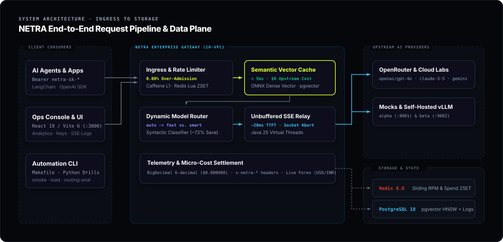
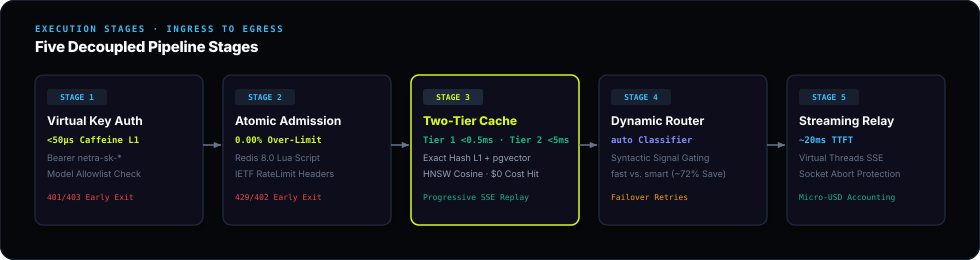
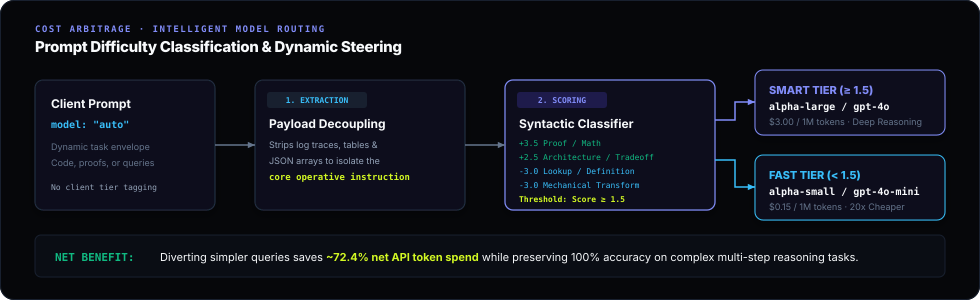

# System Architecture & Ingress Pipeline

The NETRA LLM Gateway operates as a non-blocking, tenant-isolated reverse proxy deployed in the critical path between application clients and foundation model providers.

---

## 1. High-Level System Architecture

The following diagram illustrates the complete end-to-end request lifecycle through NETRA's data plane, intelligence plane, and backing storage tiers:

---

## 2. Ingress Pipeline & Execution Stages

Every incoming HTTP request to `POST /v1/chat/completions` traverses five decoupled architectural stages:

### Stage 1: Virtual Key Authentication & L1 Ingress Cache

- Intercepts all requests via a high-precedence CORS filter (`Ordered.HIGHEST_PRECEDENCE`), safely handling cross-origin preflight `OPTIONS` calls across subdomains (`console-*` -> `gateway-*`) and exposing all `x-netra-*` and IETF `RateLimit-*` headers.
- Binds Java 25 Scoped Values for zero-allocation, immutable context propagation across the request lifecycle and child virtual threads.
- Evaluates the incoming HTTP `Authorization: Bearer netra-sk-*` header.
- Validates the key against an in-memory Caffeine L1 cache (<50μs) to eliminate database read IOPS on the fast path.
- Checks tenant status (`ACTIVE`, `SUSPENDED`, `REVOKED`) and enforces the tenant's model allowlist.
- Rejects unauthenticated or unauthorized requests immediately with HTTP 401 (`invalid_api_key`) or HTTP 403 (`model_not_allowed`).

### Stage 2: Atomic Rate Limiting & Budget Admission Control

- Dispatches an atomic Redis 8.0 Lua script.
- Evaluates sliding-window Sorted Set (ZSET) RPM counters and monthly budget spend atomically.
- Guarantees **0.00% over-admission** under high-concurrency burst traffic.
- Emits standardized IETF RateLimit headers (`RateLimit-Limit`, `RateLimit-Remaining`, `RateLimit-Reset`, `RateLimit-Policy`, `Retry-After`) compliant with `draft-ietf-httpapi-ratelimit-headers` across all admitted and throttled requests.
- If limits are exceeded, returns HTTP 429 (`rate_limit_exceeded`) or HTTP 402 (`budget_exceeded`).
- If an upstream network failure occurs later in the request lifecycle, the admitted slot is automatically rolled back via `ZREM`.

### Stage 3: Two-Tier Tenant-Isolated Semantic Vector Cache

- **Tier 1: Canonical SHA-256 Hash Near-Cache (L1 Caffeine + L2 Redis):**
    * Evaluates deterministic Unicode NFC-normalized prompt SHA-256 hashes.
    * Serves exact identical repeat prompts in **<0.5ms** at $0 compute cost, completely bypassing the ONNX embedding engine (`x-netra-cache-tier: tier1_exact`).
- **Tier 2: Dense Semantic Vector Cache (pgvector HNSW):**
    * Generates a 384-dimensional dense vector embedding in ~5ms using an in-process quantized ONNX transformer (`all-MiniLM-L6-v2`).
    * Queries PostgreSQL 18 `pgvector` using the cosine distance operator `<=>` accelerated by HNSW indexing (`m=16, ef_construction=64`).
    * Strictly partitions queries at the SQL level (`WHERE virtual_key = :key AND model_alias = :alias`), ensuring complete cryptographic tenant isolation.
    * If a match meets or exceeds the tenant similarity threshold (e.g., 0.920):
        * Returns the cached response in **sub-5ms** with `$0.000000` upstream token cost (`x-netra-cache-tier: tier2_semantic`).
        * Automatically back-populates Tier 1 so subsequent exact repeats execute in <0.5ms.
        * Replays streaming completions progressively as Server-Sent Events (SSE) ending with `data: [DONE]`.
    * **Bidirectional Streaming Cache Capture:** Upstream SSE token streams are aggregated in real time and automatically ingested into Tier-1 and Tier-2 pgvector caches upon stream completion (supporting `data: [DONE]` and clean socket EOF closures).
    * Upstream safety refusal suppression permanently prevents cache poisoning from guardrail rejections.

### Stage 4: Intelligent Model Routing, Circuit Breakers & Auto-Escalation

- Resolves model aliases (`fast`, `smart`, `auto`) or direct model identifiers.
- For `model: "auto"`:
    * Invokes the two-stage syntactic difficulty classifier.
    * Decouples task instructions from data payloads and scores grammatical complexity signals in <0.2ms.
    * Steers simple queries to `fast` models and complex reasoning tasks to `smart` models, achieving ~72.4% cost savings.
- **Resilience4j Circuit Breakers & Candidate Chain Failover:**
    * Each upstream provider is guarded by an autonomous Resilience4j circuit breaker (sliding window of 20 calls, minimum 5 calls, 50% failure rate threshold, 10s cooldown).
    * When a provider trips to OPEN, incoming requests fast-failover to partner providers in **<0.05ms** without making a network hop.
    * Enforces bounded exponential backoff retries and a strict total candidate chain deadline budget (`maxChainTimeoutMs: 15000ms`), preventing edge proxy timeouts.
    * Telemetry and circuit states are continuously exposed via `GET /admin/providers/health` and the Ops Console.
- **Small-Model Refusal & Degradation Auto-Escalation Engine:**
    * Inspects responses from cheap/small models (`alpha-small`, `beta-small`, `fast`) for refusal markers or apologies.
    * Seamlessly auto-escalates refused prompts to the high-capability frontier tier (`smart` / `alpha-large`), emitting `x-netra-escalated: true`.

### Stage 5: Unbuffered Streaming Relay & Financial Ledger

- Streams token deltas to clients over Java 25 Virtual Threads using unbuffered Server-Sent Events (~20ms Time-to-First-Token).
- **Disconnect Protection & Token Reclamation:** Detects client disconnections (`Broken pipe`) immediately and halts upstream compute within <2ms to eliminate phantom spend. If the client disconnects before tokens are generated (0 tokens), the admitted sliding-window rate limit slot is automatically rolled back via atomic Redis `ZREM`, preventing quota starvation caused by client drops.
- On stream completion, captures token counts and computes exact micro-USD costs using 6-decimal `BigDecimal` precision.
- Writes structured audit records to PostgreSQL asynchronously via a decoupled 10,000-capacity bounded batch buffer, flushing multi-row inserts and aggregated multi-tenant spend every 250ms or 100 entries to completely shield the underlying database connection pool.

---

## 3. Architecture Decision Records (ADRs)

For formal engineering decisions, architectural context, evaluated trade-offs, and design rationale across all components, explore the complete [Architecture Decision Records (ADRs)](adr.md).
