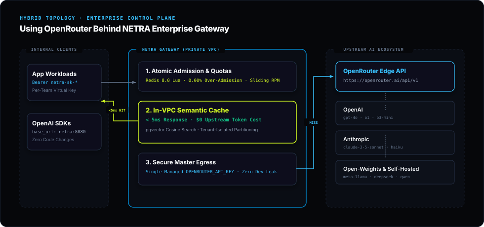

# Architecture & Gateway Comparison

This document provides a comparative analysis of **NETRA LLM Gateway** alongside common architectural patterns for generative AI applications: **Direct Provider APIs**, **Public Cloud Model Aggregators (e.g., OpenRouter, Together AI)**, and **Generic Reverse Proxies (e.g., Nginx, Envoy)**.

---

## 1. Architectural Landscape

When deploying Generative AI applications to production, engineering teams typically evaluate four architectural topologies:

1. **Direct Provider APIs (Point-to-Point):** Applications make direct HTTP calls using vendor SDKs (e.g., OpenAI, Anthropic, Google). Each service handles its own API keys, retries, and rate limits.
2. **Public Cloud Model Aggregators:** Hosted, multi-tenant public SaaS proxies (e.g., OpenRouter, Together AI, Groq) providing access to hundreds of commercial and open-weight models under a unified billing account.
3. **Generic Network Reverse Proxies (e.g., Nginx, Envoy):** Standard Layer 7 HTTP proxies handling basic SSL termination and load balancing, but unaware of LLM tokens, prompt complexity, or streaming token semantics.
4. **Private Enterprise AI Gateway (NETRA):** An in-VPC, tenant-isolated intelligent gateway and semantic vector cache that delivers predictable token economics, multi-provider failover, atomic budget guardrails, and zero data leakage.

---

## 2. Capability Matrix

| Architectural Dimension | Direct Provider APIs | Public Model Aggregators | Generic Reverse Proxy (Envoy/Nginx) | NETRA Enterprise AI Gateway |
|---|---|---|---|---|
| **Deployment Location** | Public Vendor Cloud | Public Multi-Tenant SaaS Edge | In-VPC / Cloud | **Private In-VPC / On-Premise / Edge** |
| **Data Sovereignty & Privacy** | Vendor-dependent | Transits public multi-tenant network | Private | **100% In-VPC Data Sovereignty** |
| **Semantic Vector Caching** | Costly prompt caching (vendor-locked) | None ($0 cache savings) | None (exact URL/hash only) | **Two-Tier Cache (Tier 1 SHA-256 <0.5ms + Tier 2 pgvector HNSW <5ms at $0 Cost)** |
| **Ingress API Compatibility** | Fragmented vendor SDKs | OpenAI-compatible REST API | Raw HTTP pass-through | **Drop-in OpenAI-Compatible REST API** |
| **Tenant Quota & Budget Control** | Delayed monthly invoice | Prepaid credit balance top-ups | Coarse IP/connection rate limits | **Atomic Sliding-Window RPM & Budgets (0.00% Over-Admission)** |
| **Intelligent Model Routing** | Manual model selection in code | Manual selection / basic fallback | Round-robin / least-connection | **Dynamic Complexity Classifier (`auto` tier, ~72% cost arbitrage)** |
| **Provider Resilience & Failover** | Client-side try/catch loops | Provider fallback across public hosts | HTTP 5xx retry | **Synchronous Zero-Glitch Upstream Failover Chains** |
| **Financial Accounting** | Delayed monthly invoice | Centralized credit burn-down | None | **Real-Time Micro-USD / INR Telemetry ($0.000000)** |
| **Streaming Delivery** | Raw vendor SSE | Edge SSE pass-through | Generic SSE buffering | **Unbuffered Virtual Threads Streaming Relay with Socket Reclamation** |
| **Disconnect Protection & Phantom Spend** | Continues billing to end of stream | Continues billing to end of stream | Buffers until socket drops | **Zero Phantom Spend (Instant Socket Severing & Upstream Cutoff)** |
| **Semantic Boundary Discrimination** | Exact string or costly prompt cache | None ($0 cache savings) | Exact URL/hash matching | **Cosine Boundary Discrimination (Near-Miss Rejection Guard)** |
| **Licensing & Governance** | Closed-source proprietary | Closed-source proprietary SaaS | Open Source | **100% Open Source (Apache 2.0)** |

---

## 3. Deep-Dive: Key Architectural Differences

### 3.1 Data Residency & Sovereign AI Infrastructure

- **Public Model Aggregators:** Applications forward all prompts and completions across public third-party SaaS proxy networks. While convenient for rapid prototyping and accessing diverse hosted models under one billing balance, enterprise compliance standards (HIPAA, SOC 2, GDPR, internal zero-data-retention mandates) often prohibit sending internal data or customer PII through third-party multi-tenant aggregator proxies.
- **NETRA Gateway:** Deployed directly within your private cloud (AWS VPC, GCP, Azure), on-premise infrastructure, or container platforms. Your prompts, completions, embeddings, and audit logs never leave your designated network boundaries.

### 3.2 Semantic Vector Caching & Token Economics

- **Public Model Aggregators:** Public aggregators bill for every token generated on every query. If 1,000 users ask identical or paraphrased questions (e.g., customer support FAQs, documentation lookups, onboarding prompts), 1,000 full upstream API calls are made and billed.
- **NETRA Gateway:** Deploys a two-tier cache hierarchy: Tier 1 evaluates deterministic Unicode NFC prompt SHA-256 hashes against an in-memory Caffeine + Redis 8 near-cache (<0.5ms). Tier 2 evaluates dense vector embeddings via in-process ONNX (`all-MiniLM-L6-v2`) and PostgreSQL `pgvector` HNSW index (<5ms). When matched above the tenant similarity threshold, NETRA serves the completion in **sub-millisecond or sub-5ms latency** with **$0.000000 upstream token cost**, while enforcing cryptographic tenant isolation so namespaces never leak cached completions across virtual keys. Semantic hits automatically back-populate Tier 1 for subsequent instantaneous matches.

### 3.3 Atomic Admission Control & Zero Over-Admission

- **Direct APIs & Standard Proxies:** Rate limiting in standard proxies typically uses leaky buckets or in-memory token counters that suffer from Time-of-Check to Time-of-Use (TOCTOU) race conditions under concurrent load bursts. This leads to rate-limit breaches (HTTP 429) and budget overruns.
- **NETRA Gateway:** Executes single-command atomic Redis 8.0 Lua scripts combining sliding-window Sorted Set (ZSET) rate limiting and monthly budget verification in a single atomic transaction. In verified high-concurrency benchmarks, NETRA achieves **0.00% over-admission**, with automatic slot rollback (`ZREM`) on upstream failures.

### 3.4 Dynamic Cost Arbitrage (`auto` Tier)

- **Manual Selection:** Developers often default to expensive frontier models (e.g., GPT-4o, Claude 3.5 Sonnet) for all tasks because they do not know in advance which prompts require complex reasoning. This leads to massive cost overruns on simple summarization, classification, or extraction tasks.
- **NETRA Gateway:** Implements a two-stage syntactic difficulty classifier for the `auto` model alias. It isolates actionable instructions from large data payloads and scores grammatical complexity signals in sub-millisecond time. Simpler queries are automatically steered to cost-effective models (`fast`), while complex multi-step reasoning tasks are steered to frontier models (`smart`), achieving up to **~72.4% cost savings** with 100% benchmark accuracy.

---

## 4. Complementary Architecture: Upstream Model Aggregators *Behind* NETRA

Sovereign enterprise gateways and public model aggregators are complementary rather than mutually exclusive. In fact, engineering teams can configure **model aggregators (such as OpenRouter) as an upstream provider behind NETRA**:

In this hybrid topology:

1. **Client Ingress within VPC:** Client applications connect to NETRA within the local network or VPC using tenant virtual keys (`netra-sk-*`).
2. **Local Governance & Semantic Cache:** NETRA evaluates atomic rate limits, monthly budgets, and sub-5ms semantic cache hits directly inside your private infrastructure.
3. **Secure Centralized Egress:** On cache misses, NETRA routes through a centralized upstream aggregator key (`OPENROUTER_API_KEY`), granting your internal teams access to a diverse catalog of foundation models without managing individual vendor billing accounts or exposing master provider credentials to application developers.

---

## 5. Architectural Decision Guide

- **Choose Direct Provider APIs if:** You are building a single-model prototype with minimal traffic, no budget constraints, and no requirement for multi-provider failover or caching.
- **Choose a Public Model Aggregator directly if:** You are an indie developer or early-stage team wanting a single unified API and credit card checkout across diverse models, with no strict data residency, private VPC, or internal multi-tenant quota enforcement requirements.
- **Choose NETRA Enterprise Gateway if:** You are an engineering organization that requires:

    * Strict data sovereignty and zero data leakage.
    * Sub-5ms semantic caching to eliminate redundant token costs.
    * Granular virtual key quotas, sliding RPM limits, and hard monthly budgets.
    * Centralized observability, live SSE request streams, and multi-currency accounting.
    * An open-source (Apache 2.0) control plane that you own, deploy, and customize.
