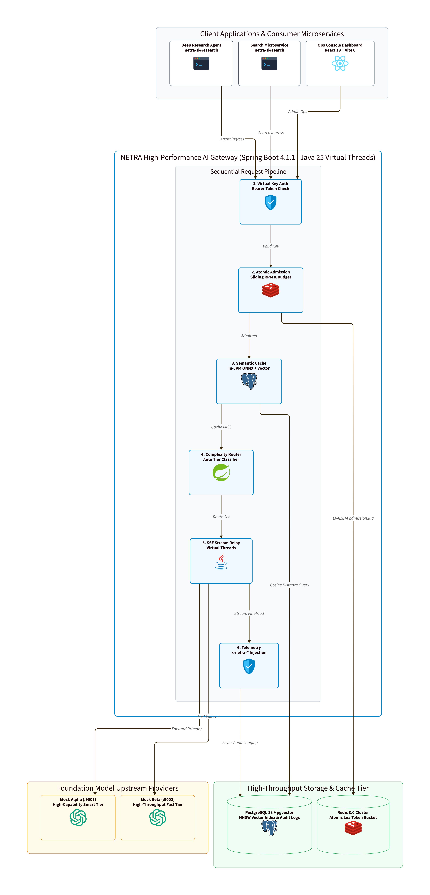

# NETRA Architecture & Core Specification

Welcome to the technical documentation for **NETRA** — an enterprise AI-First LLM Gateway and Semantic Vector Cache built on Java 25 LTS Virtual Threads, PostgreSQL 18 with `pgvector`, and Redis 8.0.

---

## System Architecture & Component Topology

  
   
  <em>Figure 1: NETRA End-to-End System Architecture &amp; Component Topology (<a href="diagrams/01_system_architecture.svg">Vector SVG</a> · <a href="diagrams/01_system_architecture.d2">D2 Source</a>)</em>

---

## Ingress Contract & Headers

Every successful chat completion response from `POST /v1/chat/completions` strictly emits canonical `x-netra-*` telemetry headers:

| Header | Description | Example |
|---|---|---|
| `x-netra-provider` | Upstream provider and model that served the request | `alpha/alpha-small` |
| `x-netra-cache` | Indicates whether the response was served from cache | `hit` or `miss` |
| `x-netra-fallback` | Indicates if an upstream failover provider was used | `false` or `true` |
| `x-netra-cost-usd` | Computed cost in micro-USD ($0.000000 USD) *(omitted on streaming responses upfront)* | `0.000011` |
| `x-netra-route-reason` | Decision rationale applied by the dynamic model router | `auto -> smart (score +3.5): +3.5 proof` |
| `x-netra-retries` | Number of upstream network retries executed before success | `0` (or `1`, `2`, `3`) |

---

## Multi-Provider Routing & Intelligent Auto Classifier
NETRA implements high-availability provider resilience and machine-assisted model steering:
- **Ordered Fallback Chains**: Aliases (`fast`, `smart`) and direct models resolve to candidate chains (e.g. `alpha/alpha-small` -> `beta/beta-small`).
- **Bounded Exponential Retries**: Transient HTTP 5xx, 429, and timeouts are absorbed across 3 attempts (`initial_backoff_ms: 200`, `multiplier: 2.0`).
- **Synchronous Upstream Failover**: Streaming SSE connects upstream synchronously before emitting headers, ensuring zero-glitch provider failover.
- **Two-Stage Prompt Difficulty Classifier**: For the `auto` alias, task instructions are decoupled from wrapped data payloads (`extractInstruction()`) to evaluate grammatical complexity signals, achieving 100% accuracy on benchmark evaluations.

---

## High-Throughput Streaming SSE Relay
NETRA supports token-by-token pass-through streaming over Server-Sent Events (`stream: true`) utilizing native Java 25 Virtual Threads:
- **Zero-Delay Pass-Through**: Line-by-line streaming relay with 1KB buffers for progressive delivery (~20ms per token).
- **Socket Reclamation**: Immediate closure of upstream sockets upon client disconnect (`Broken pipe`), preventing phantom token generation.
- **Terminal Accounting**: Captures terminal token usage chunks and executes post-stream micro-USD cost settlement.
